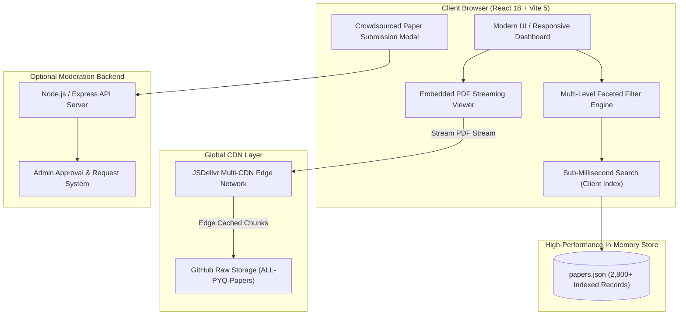

# 📚 PYQSphere — National Previous Year Question Papers Portal

[](https://pyqs-shabber10.onrender.com)
[](https://react.dev)
[](https://vitejs.dev)
[](https://www.jsdelivr.com/)
[](LICENSE)

> A blazing-fast, ad-free academic search and discovery platform indexing over **2,800+ Previous Year Question Papers (PYQs)** across National Competitive Exams, Engineering, Medical, Civil Services, and State Boards with sub-millisecond client-side filtering and in-browser PDF streaming.

🔗 **Live Application URL**: [https://pyqs-shabber10.onrender.com](https://pyqs-shabber10.onrender.com)  
📦 **Main Archive Repository**: [Shabber10/ALL-PYQ-Papers](https://github.com/Shabber10/ALL-PYQ-Papers)  
👨‍💻 **Developer Portfolio**: [https://shabber-portfolio.onrender.com](https://shabber-portfolio.onrender.com)

---

## 🌟 Executive Overview

Students preparing for high-stakes examinations (JEE Main/Advanced, NEET, UPSC Civil Services, GATE, CBSE, ICSE, and State Boards) often face clunky, ad-saturated, and fragmented portals with broken links and slow downloads. 

**PYQSphere** solves this by providing:
1. **Zero-Latency Search**: Complete catalog search across 2,800+ papers executing in **< 5 milliseconds** via optimized in-memory inverted indices.
2. **Direct In-Browser PDF Streaming**: Leverages JSDelivr's distributed Edge CDN to bypass GitHub file-size bottlenecks and stream PDFs directly into a responsive, modal-based PDF reader.
3. **Crowdsourced Pipeline**: Students can request missing exam papers or submit newly held exam question papers through structured submission modals.
4. **Admin Moderation & Quality Gate**: Built-in review queue allowing administrators to verify, approve, or reject user-submitted papers before they enter the public catalog.

---

## 🏗️ System Architecture & Data Flow



---

## ✨ Key Features & Capabilities

### 🔍 Advanced Multi-Tier Faceted Filtering
- **Hierarchy Filtering**: Narrow by Category (Boards, Engineering, Medical, Civil Services) &rarr; Subcategory (CBSE, JEE Main, NEET UG, UPSC CSE) &rarr; Subject &rarr; Exam Year.
- **Dual View Modes**: Switch seamlessly between **Card Grid View** (with rich metadata badges) and **Compact Table View** (for rapid enterprise skimming).
- **KPI Real-Time Stats**: Live dashboard counters displaying total indexed papers, active categories, verified files, and student requests.

### ⚡ Direct Inline PDF Streaming
- No heavy local downloads or third-party redirection required.
- Opens instantly inside a lightweight, responsive modal reader with full-screen, zoom, and print controls.
- Distributed across worldwide CDN edge nodes for instantaneous rendering even on 3G/4G networks.

### 🤝 Community Submission & Request Workflows
- **Request a Paper**: Students can submit requests for specific years, subjects, or newly conducted exams.
- **Upload & Share**: Students can upload scanned question papers directly to the platform.
- **Admin Review Queue**: Secure admin portal for moderating student submissions and publishing validated materials.

### 🌓 Premium Adaptive Glassmorphism UI
- Fully responsive across mobile, tablet, and widescreen desktop layouts.
- Dynamic **Dark Mode & Light Mode** with smooth CSS variable transitions and curated contrast levels designed for long study sessions.

---

## 📂 Project Directory Structure

```plaintext
Website-for-PYQs/
├── public/                     # Static production assets
│   ├── _redirects              # SPA client-side routing fallback
│   └── favicon.png             # Application brand icon
├── src/                        # React Application Source
│   ├── components/             # Reusable modular UI components
│   │   ├── AdminApprovalModal.jsx   # Admin moderation approval interface
│   │   ├── AdminLoginModal.jsx      # Admin authentication portal
│   │   ├── AdminRequestsModal.jsx   # Student requests review dashboard
│   │   ├── DetailsPanel.jsx         # Paper detailed metadata sidebar
│   │   ├── FilterBar.jsx            # Category, branch, and year filter controls
│   │   ├── GridCards.jsx            # Responsive paper card grid
│   │   ├── Header.jsx               # Navigation bar, search input, brand identity
│   │   ├── KPICards.jsx             # Metric summary cards (Total, Categories, Years)
│   │   ├── PdfModal.jsx             # Embedded CDN PDF streaming viewer
│   │   ├── RequestPaperModal.jsx    # Missing paper submission form
│   │   ├── Table.jsx                # High-density data table view
│   │   ├── ThemeToggle.jsx          # Dark/Light mode theme switch
│   │   ├── UploadPdfModal.jsx       # Student contribution upload modal
│   │   └── UserUploadsModal.jsx     # User submission status tracker
│   ├── data/                   # Bundled search dataset
│   │   └── papers.json              # 2,800+ pre-compiled paper metadata records
│   ├── services/               # API service layer
│   │   └── api.js                   # Client REST connectors & submission hooks
│   ├── App.jsx                 # Root application state & router
│   ├── index.css               # Design system, glassmorphism, and responsive CSS
│   └── main.jsx                # DOM mounting & React root
├── server/                     # Optional Node.js Moderation Backend
│   ├── models/                 # Database schemas
│   │   └── SubmittedPdf.js          # Mongoose schema for user-submitted papers
│   ├── routes/                 # REST API endpoints
│   │   ├── adminRoutes.js           # Admin authentication & review endpoints
│   │   └── pdfRoutes.js             # Upload & request handler routes
│   └── index.js                # Express application bootstrap
├── index.html                  # HTML entry point with metadata tags
├── netlify.toml                # Netlify deployment configuration
├── render.yaml                 # Render infrastructure-as-code blueprint
├── vite.config.js              # Vite 5 bundling and build configuration
└── package.json                # Project dependencies and npm scripts
```

---

## 🛠️ Technology Stack & Dependencies

| Layer | Technologies Used |
| :--- | :--- |
| **Frontend Framework** | React 18.3, JSX, Modern Hooks (`useState`, `useMemo`, `useEffect`) |
| **Build & Tooling** | Vite 5.4, ESBuild |
| **Styling & Theme** | Modern Responsive CSS3, CSS Custom Properties, Glassmorphism, Dark/Light Mode |
| **Icons & Typography** | Lucide React (`lucide-react`) |
| **Content Delivery** | JSDelivr Edge CDN, GitHub Raw Content API |
| **Backend & API** | Node.js, Express 4.x, Multer, CORS (for upload/admin features) |
| **Database (Optional)**| MongoDB / Mongoose (for moderation and user-request persistence) |
| **Deployment** | Render Static Sites (Edge CDN, 0 cold-start, 0 MB container RAM) |

---

## 🚀 Getting Started Locally

### Prerequisites
- **Node.js** >= 18.0.0
- **npm** >= 9.0.0 or **yarn** / **pnpm**

### Installation

1. **Clone the repository:**
   ```bash
   git clone https://github.com/Shabber10/Website-for-PYQs.git
   cd Website-for-PYQs
   ```

2. **Install frontend dependencies:**
   ```bash
   npm install
   ```

3. **Launch the development server:**
   ```bash
   npm run dev
   ```
   Open [http://localhost:5173](http://localhost:5173) in your browser to view the application with hot module replacement (HMR).

4. **Build for production:**
   ```bash
   npm run build
   ```
   The compiled, minified, and optimized assets will be emitted to the `dist/` directory.

---

## 🌐 Production Deployment

The web application is deployed live on **Render Static Sites** powered by Render's global Edge CDN:

- **Live URL**: [https://pyqs-shabber10.onrender.com](https://pyqs-shabber10.onrender.com)
- **Build Command**: `npm install && npm run build`
- **Publish Directory**: `dist`
- **Branch**: `main`
- **HTTP Routing**: `public/_redirects` ensures clean single-page application (SPA) routing for deep links.

---

## 🛡️ License

This project is licensed under the **MIT License** — see the [LICENSE](LICENSE) file for details.

---

## 👨‍💻 Author & Connect

**Shabber Hussain**  
*Full-Stack Engineer & AI Developer*

- 🌐 **Developer Portfolio**: [https://shabber-portfolio.onrender.com](https://shabber-portfolio.onrender.com)
- 🐙 **GitHub Profile**: [@Shabber10](https://github.com/Shabber10)
- 💼 **LinkedIn**: [Connect with Shabber](https://www.linkedin.com/in/shabber-hussain/)
- 📧 **Contact**: `shabberhussain934@gmail.com`
